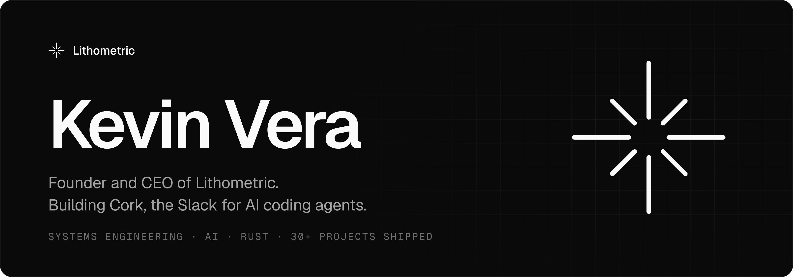
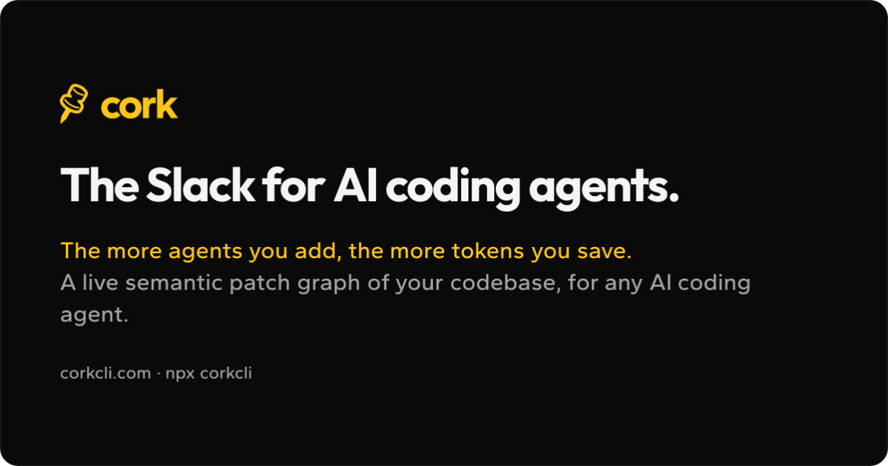
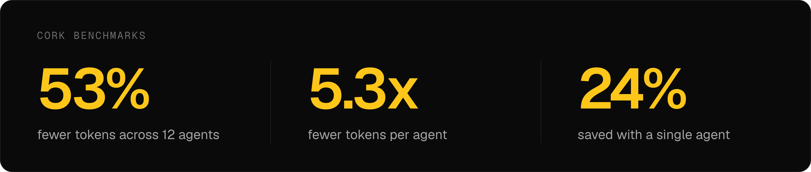
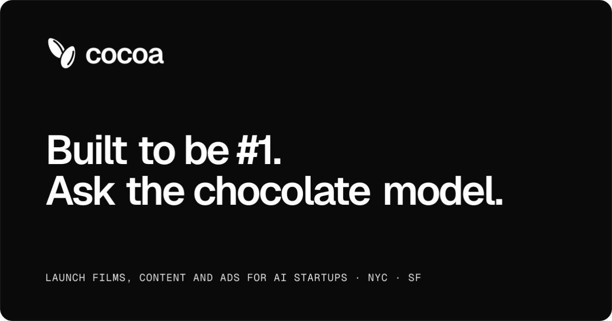
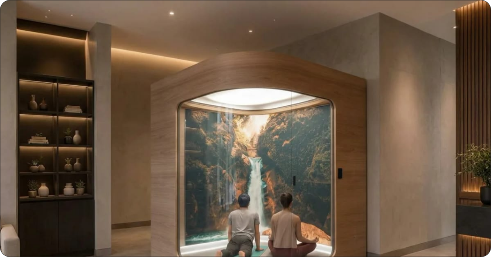
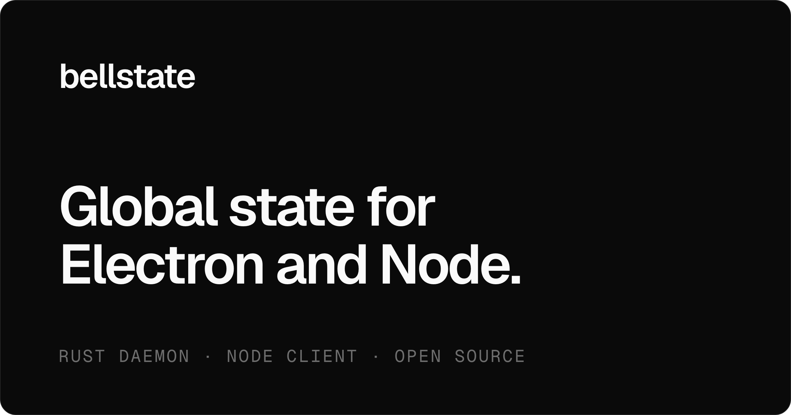
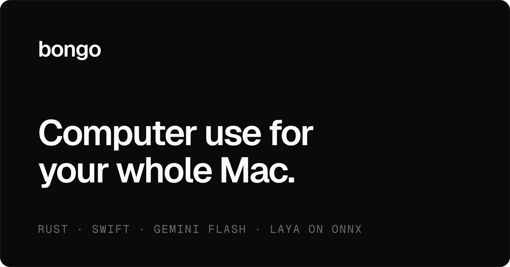
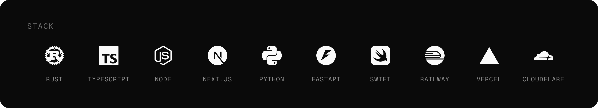

<a href="https://lithometric.com"></a>

<p align="center">
  <a href="https://x.com/kevinvera"><b>X</b></a>&nbsp;&nbsp;·&nbsp;&nbsp;
  <a href="https://www.linkedin.com/in/kevinverali"><b>LinkedIn</b></a>&nbsp;&nbsp;·&nbsp;&nbsp;
  <a href="https://www.youtube.com/@kevinverayt"><b>YouTube</b></a>&nbsp;&nbsp;·&nbsp;&nbsp;
  <a href="https://www.tiktok.com/@kevinveratt"><b>TikTok</b></a>&nbsp;&nbsp;·&nbsp;&nbsp;
  <a href="https://www.instagram.com/kevinveraig"><b>Instagram</b></a>&nbsp;&nbsp;·&nbsp;&nbsp;
  <a href="mailto:kevin@lithometric.com"><b>Email</b></a>
</p>

<br>

I build solo, Rust first, and I've shipped 30+ projects across agent infrastructure, computer use, edge hardware and iOS. [Lithometric](https://lithometric.com) is the principal systems engineering and AI firm behind all of it, and each company below runs out of its own GitHub org.

Union, New Jersey. In San Diego for the year, working on San Francisco hours.

<br>

## Cork

<a href="https://corkcli.com"></a>

Cork lets Claude Code, Codex, Cursor and Hermes work in one codebase at the same time without overwriting each other or burning tokens rediscovering context. Git catches two agents on the same line. Cork catches two agents on the same idea.

```console
npx corkcli
```



Hooks, a live listener and an MCP server, backed by a Rust engine: tree sitter parsing, a symbol level Merkle tree store, a typed edit algebra, and symbol anchored memory with content hash staleness detection. Cork never stores your code.

[corkcli.com](https://corkcli.com)&nbsp;&nbsp;·&nbsp;&nbsp;[github.com/corkcli](https://github.com/corkcli)&nbsp;&nbsp;·&nbsp;&nbsp;[corkcli/cork](https://github.com/corkcli/cork)

<br>

## Companies

<table>
  <tr>
    <td width="50%" valign="top">
      <a href="https://cocoafolk.com"></a>
      <p><b>Cocoa</b><br>Launch films, content and ads for AI startups, out of NYC and SF.</p>
      <p><a href="https://cocoafolk.com">cocoafolk.com</a>&nbsp;&nbsp;·&nbsp;&nbsp;<a href="https://github.com/cocoafolk">github.com/cocoafolk</a></p>
    </td>
    <td width="50%" valign="top">
      <a href="https://vitalelement.co"></a>
      <p><b>Vital Element</b><br>One chamber, every modality. Principal systems engineer: I designed and built VitalOS, which reads the body with zero wearables across Raspberry Pi edge control, FastAPI, Firebase and a native iOS app.</p>
      <p><a href="https://vitalelement.co">vitalelement.co</a>&nbsp;&nbsp;·&nbsp;&nbsp;<a href="https://github.com/VitalElement-Inc">github.com/VitalElement-Inc</a></p>
    </td>
  </tr>
</table>

<br>

## Side projects

<table>
  <tr>
    <td width="50%" valign="top">
      <a href="https://github.com/kevinveragh/bellstate"></a>
      <p><b>bellstate</b><br>Synchronous global state across processes and across separate Electron apps, coordinated through Unix socket leader election. Rust daemon, Node client, MIT.</p>
      <p><a href="https://github.com/kevinveragh/bellstate">kevinveragh/bellstate</a></p>
    </td>
    <td width="50%" valign="top">
      <a href="https://github.com/kevinveragh/bongo"></a>
      <p><b>Bongo</b><br>A computer use agent that runs on your own Mac, in the background, while you keep working. A Gemini Flash planner, Laya on ONNX choosing each click, a ghost cursor, and approval on anything that sends, posts or pays.</p>
      <p><a href="https://github.com/kevinveragh/bongo">kevinveragh/bongo</a></p>
    </td>
  </tr>
</table>

Also a browser agent on headed Chrome that observes the accessibility tree over CDP, with a three valued PASS / FAIL / UNKNOWN verification contract.

Earlier: [BlenderBin](https://www.blenderbin.com), a Blender add on platform. [SHP](https://github.com/lithometric/jeroshp), a self healing protocol. Retro, a blockchain.

<br>

## Stack



Deep in Electron IPC, tree sitter, Merkle trees, embeddings, MCP servers, agent harness hooks and computer use through CDP, Playwright and the AX tree.

<br>

## Background

Amazon. Production work for Tata Technologies. Student researcher on early AI vision and lip syncing models. Studied at Union College of Union County and Rowan University.

Thinking long term about quantum computing, connectomics and digital brain emulation.

<br>

<p align="center"><a href="https://lithometric.com">lithometric.com</a>&nbsp;&nbsp;·&nbsp;&nbsp;<a href="https://github.com/lithometric">github.com/lithometric</a></p>
